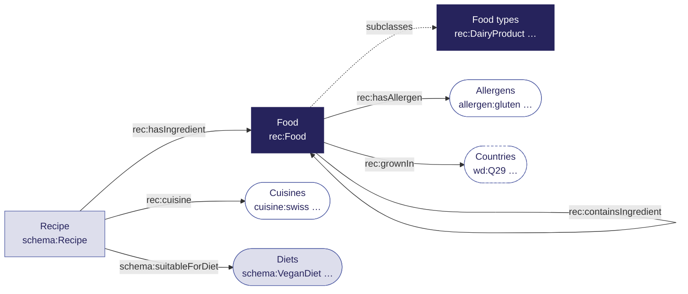

# One model that works

  our own terms (<code>rec:</code>)
  reused from schema.org
  our own lists, written with SKOS
  external data: Wikidata

There's no single right model, but there is one that answers your questions.

<!--
Boxes are classes; rounded nodes are fixed lists of values, shown with an example IRI.
SKOS is not a source but a vocabulary for writing such lists (concepts, labels, broader/narrower).
Point out containsIngredient: products like Worcestershire sauce have ingredients of their own.
That is where hidden anchovies and gluten live. Full model: data/vocab/recipes.ttl.
-->
