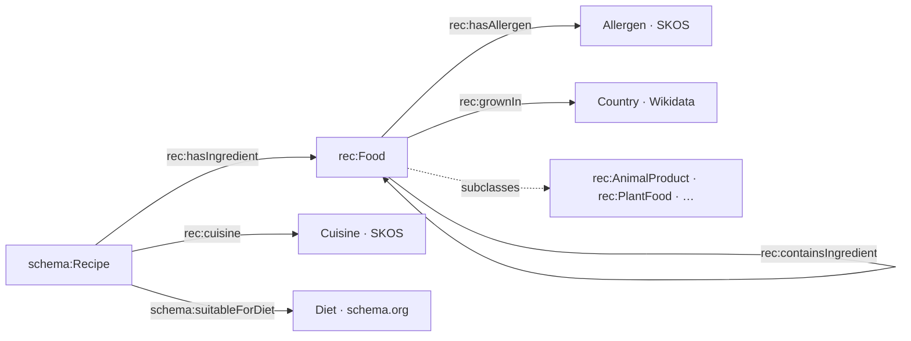

# One model that works

There's no single right model, but there is one that answers your questions.

<!--
Point out containsIngredient: products like Worcestershire sauce have ingredients of their own.
That is where hidden anchovies and gluten live. Full model: data/vocab/recipes.ttl.
-->
