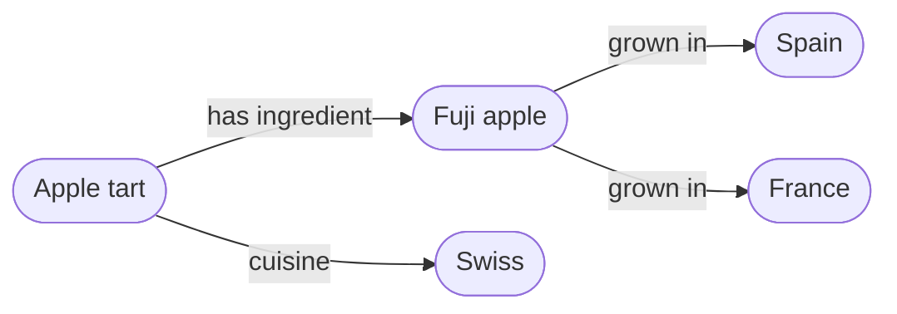

# What is a knowledge graph?

::left::

- **Nodes** are things: a recipe, an apple, a country
- **Edges** are named relations between them
- Every node and edge has a **global identifier**

::right::

::bottom::

Sources: Hogan et al. 2021

<!--
Poll: who has met "knowledge graph" at work? Web search, Wikidata, enterprise data catalogues.
Everything today uses one example: a recipe knowledge graph.
-->
