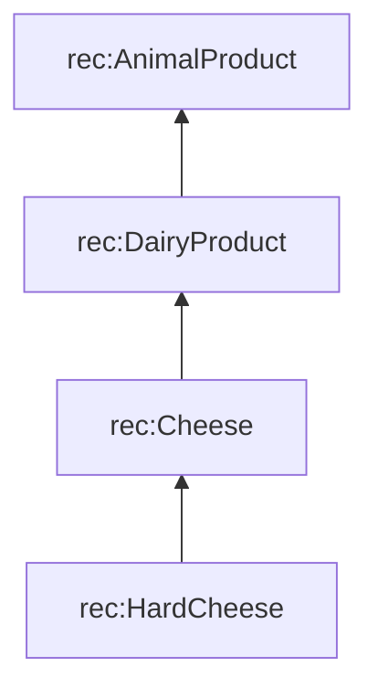
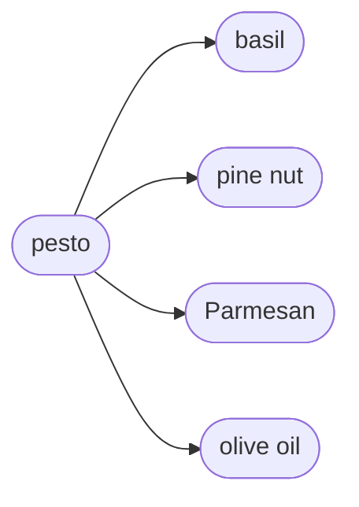

# Taxonomy and meronomy

::left::

## Taxonomy: *is a kind of*

RDFS reasoners and SHACL engines read <code>rdfs:subClassOf</code> as a rule: every hard cheese is also a cheese, a dairy product and an animal product. Whatever holds for all animal products, such as the vegan check, also holds for every hard cheese.

`rdfs:subClassOf`

::right::

## Meronomy: *is part of*

`rec:containsIngredient`

::bottom::

Sources: W3C RDF Schema 1.1 · Winston et al. 1987

<!--
Taxonomies support inference ("Parmesan is an animal product").
The popup: a subclass inherits everything said about all members of its superclasses. In RDF, properties are not owned by classes as in object-oriented code,
so "inherits" means: domain and range, OWL restrictions and SHACL shapes for rec:AnimalProduct also apply to every rec:HardCheese.
SHACL follows rdfs:subClassOf in the data graph for sh:targetClass and sh:class; SPARQL needs a path (a/rdfs:subClassOf*) or a reasoner.
Meronomies support "what is inside": the vegan check follows both, recipe → pesto → Parmesan → AnimalProduct.
-->
