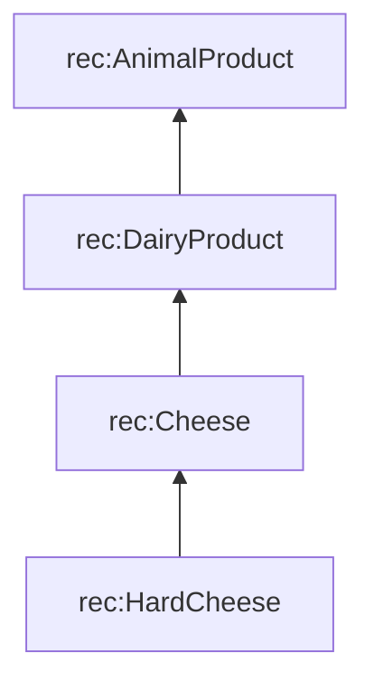

# Kind of, or part of?

::left::

## Taxonomy: *is a kind of*

`rdfs:subClassOf`

::right::

## Meronomy: *is part of*

`rec:containsIngredient`

<!--
Taxonomies support inference ("Parmesan is an animal product").
Meronomies support "what is inside": the vegan check follows both, recipe → pesto → Parmesan → AnimalProduct.
-->
