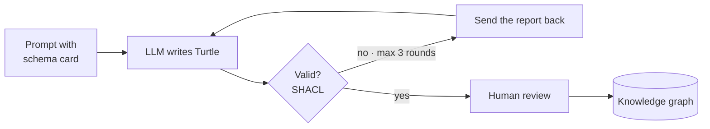

# Generate, validate, repair

LLMs draft, SHACL checks, humans decide.

<!--
The same loop works for ontology drafting, entity extraction from text and synthetic test data.
Cap the retries; if it still fails, a person looks at it. Label synthetic data as synthetic.
-->
