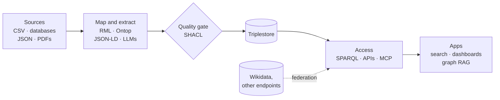

# A knowledge graph is a pipeline

Map, validate, store, serve. Graph RAG is just one more consumer.

<!--
Example: a canteen allergen graph built from supplier CSV files (RML), recipe pages (JSON-LD),
recipe PDFs (LLM extraction) and Wikidata (federation), checked with SHACL, served to a menu app and a chatbot.
-->
