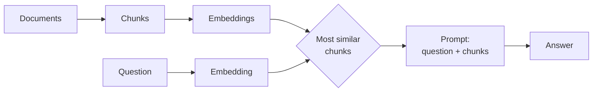

# Vector RAG in one picture

- Good at: "what does the text say about X?"
- Blind to: facts spread over several documents, totals, strict rules

<!--
Chunk, embed, retrieve the top-k most similar chunks, paste them into the prompt.
It stays the right tool for single-hop lookups in text, and it is cheap to set up.
-->
