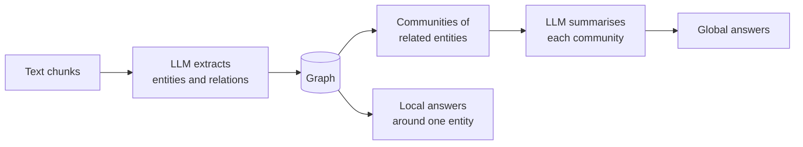

# Family A: graphs built by an LLM

- Microsoft GraphRAG (Edge et al., 2024); LightRAG and HippoRAG 2 are lighter variants
- Answers "what are the main themes?" over a large pile of text
- Costs many LLM calls to build, and again when the text changes

<!--
GraphRAG: arXiv 2404.16130. LightRAG: arXiv 2410.05779 (dual-level retrieval, incremental updates).
HippoRAG: arXiv 2405.14831, HippoRAG 2: arXiv 2502.14802 (personalised PageRank over the graph).
The graph is only as good as the extraction: no shapes, no shared IRIs by default.
-->
