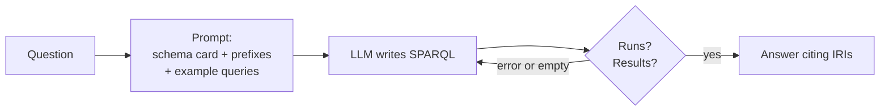

# Family B: the LLM writes the query

- The schema card can be generated from your SHACL shapes
- Answers are exact and traceable: every fact is a triple you can show
- Fragile when the LLM guesses IRIs or prefixes: give examples, and retry

Sources: Emonet et al. 2024

<!--
Our q01–q11 queries double as examples for few-shot prompting.
SIB's federated assistant (arXiv 2410.06062) checks generated queries against dataset descriptions before running them.
-->
