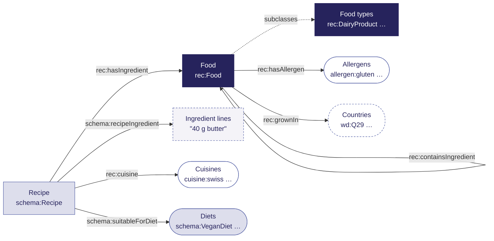

# One model that could work

  <b>2</b> What can I cook for a vegetarian, gluten-free guest?
  <b>3</b> Which recipes use ingredients grown in Spain?

  our own terms (<code>rec:</code>)
  reused from schema.org
  our own lists, written with SKOS
  external data: Wikidata
  text value

<!--
Other models can work too; check yours against the five competency questions.
Question 2: Recipe -> rec:hasIngredient -> Food (and rec:containsIngredient for products) -> rec:hasAllergen gluten; meat and fish are food types (subclasses). Hands-on 3 query q09.
Question 3: Recipe -> rec:hasIngredient -> Food -> rec:grownIn -> wd:Q29. Hands-on 3 query q06.
The same model also answers questions 4 (fish) and 5 (cuisines, diets); question 1 needs schema:totalTime, which the diagram leaves out.
Boxes are classes; rounded nodes are fixed lists of values, shown with an example IRI.
SKOS is not a source but a vocabulary for writing such lists (concepts, labels, broader/narrower).
Two ingredient edges: schema:recipeIngredient holds the recipe's text lines as written; schema.org expects plain text there, so links to Food things use our own rec:hasIngredient.
Point out containsIngredient: products like Worcestershire sauce have ingredients of their own.
That is where hidden anchovies and gluten live. Full model: src/data/vocab/recipes.ttl.
-->
