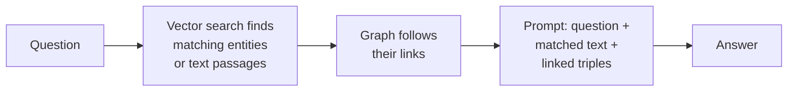

# Family C: vector search, then the graph

- Vector search matches the question's wording to entity labels or passages, synonyms included
- The graph then adds the facts linked to those matches, up to a hop limit or through a query
- When the data changes, both the embeddings and the graph need updating
- HybridRAG, tested on earnings-call transcripts, scored higher than vector or graph retrieval alone

Sources: Peng et al. 2024 · Sarmah et al. 2024

<!--
Recipe example: "Is that salad with the anchovy dressing safe for a fish allergy?" Vector search matches the wording to Caesar salad.
The graph then follows rec:hasIngredient/rec:containsIngredient* to Worcestershire sauce, anchovy and allergen:fish.
Peng et al. survey graph RAG in three stages: graph-based indexing, graph-guided retrieval, graph-enhanced generation. Retrieval can return nodes, triples, paths or subgraphs.
HybridRAG (arXiv 2408.04948): context from a vector database and a knowledge graph, on Q&A from financial earnings calls.
It beat each method alone on retrieval accuracy and answer generation. The abstract gives no numbers and the paper names no venue.
The matches are a black box (see "Three ways to bring in a graph"): they come from a similarity score and shift when the embedding model or index changes.
-->
